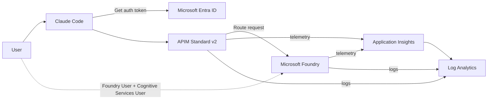
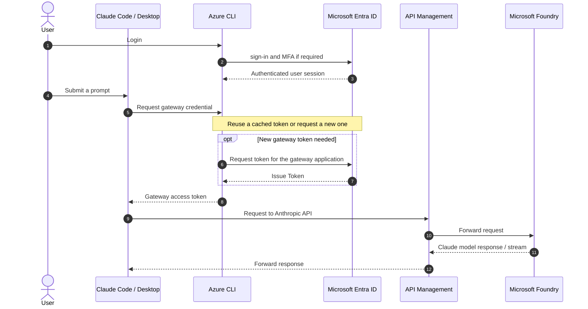

# Claude Code with Microsoft Foundry

> [!info] Japanese Guide
> 日本語での説明はこちらです：[README_JP.md](README_JP.md)

The [Terraform templates](./azure_infra) provision Claude models **Hosted on Azure** and expose their native Anthropic API through API Management. See the [deployment guide](./DEPLOYMENT.md) for configuration, and verification.

## Architecture

### Resources
The following Azure Resources are going to be deployed:
| Name | Description |
| - | - |
| Resource Group | |
| Azure API Management | |
| Microsoft Foundry | |
| Azure Application Insights | | 
| Azure Log Analytics | |
| Entra ID App Registration | |

By default, these models are deployed (can be configured in the `terraform.tfvars` file):
| Deployment/model ID |
| --- |
| `claude-opus-5-5` |
| `claude-haiku-4-5` |
| `claude-sonnet-5` |
| `claude-opus-5` |
| `claude-sonnet-5-5` |
| `claude-haiku-5-5` |

Also, `Foundry User` and `Cognitive Services User` and `Log Analytics Reader` roles are grated to the user to be able to access the models on Foundry and monitoring details.

## Authentication
Azure CLI is used to obtain a short-lived Entra token for the gateway application on behalf of the user.
Claude Code or Desktop sends this token to APIM, which validates its signature, issuer, expiry, audience, and app role.
APIM then replaces the user token with its own managed-identity token; Foundry authorizes APIM through the `Cognitive Services User` role and returns the model response.

## Observability and data handling

This deployment provides centralized monitoring, token usage tracking, and rate limiting through Azure API Management (APIM), Application Insights, and Log Analytics.

| Service | Collected telemetry |
| --- | --- |
| Application Insights | APIM request and dependency telemetry, plus `claudecode` token usage metrics categorized by `UserId` and `Model`. |
| Log Analytics | Azure Monitor APIM gateway logs and Microsoft Foundry platform diagnostic logs. |
| Microsoft Foundry | Project-level telemetry where supported, when connected to Application Insights. |

