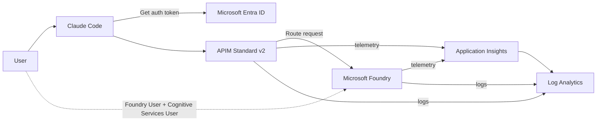

# Claude Code with Microsoft Foundry

The [Terraform templates](./src) provision Claude models **Hosted on Azure** and expose their native Anthropic API through API Management. See the [deployment guide](./DEPLOYMENT.md) for configuration, migration, and verification.

## Architecture

### Resources

| Name | Description |
| - | - |
| Resource Group | |
| Azure API Management | |
| Microsoft Foundry | |
| Azure Application Insights | | 
| Azure Log Analytics | |
| Entra ID App Registration | |

Models to be deployed:
| Deployment/model ID |
| --- |
| `claude-opus-5-5` |
| `claude-haiku-4-5` |
| `claude-sonnet-5` |
| `claude-opus-5` |
| `claude-sonnet-5-5` |
| `claude-haiku-5-5` |

`Foundry User` and `Cognitive Services User` roles are grated on the Foundry resource for configured users/groups, plus `Log Analytics Reader` on Application Insights and Log Analytics.

## Authentication

Claude Code uses **Anthropic gateway mode**, `ANTHROPIC_BASE_URL`, and the [Entra token helper](./client/get-claude-gateway-token.ps1). After `az login`, the helper obtains short-lived tokens for `api://<gateway-client-id>/.default`; Claude Code reruns it every five minutes. Despite Claude Code naming the setting `apiKeyHelper`, its output is an **Entra bearer token, not an API key**. APIM reads only `Authorization: Bearer`, not key headers.

APIM validates the tenant, signature, expiry, and **gateway app audience**, then requires the exact `Claude.Standard` role and a caller object ID before requesting any backend token. This registration requests **v2 access tokens**, whose `aud` is the app's client-ID GUID, not its `api://...` URI. Missing/invalid tokens return 401; a valid gateway token without the required role returns 403. Tokens for the Foundry AI/Cognitive Services audiences are deliberately rejected at the gateway.

APIM replaces the user's bearer token with its own system-assigned managed-identity token for `https://cognitiveservices.azure.com`. Foundry authorizes **APIM**, not the user, for gateway inference. APIM caches and refreshes this backend token. Client identity is captured before replacement for authorization, rate limits, quotas, and metrics. API-key headers are stripped, key-only requests cannot authenticate, and Foundry local authentication remains disabled. No client secrets, callback ports, or APIM subscription keys are used.

Entra evaluates user/group app-role assignments when issuing tokens; APIM no longer embeds group membership snapshots. Group-based enterprise-application assignment requires appropriate Entra licensing and supports **direct members, not nested groups**. Group membership changes need no Terraform update, but role/consent propagation and already-issued token lifetimes still apply; revocation isn't instantaneous. Changes to the configured assigned users/groups themselves still require Terraform apply.

This implements the article's gateway app registration and managed-identity backend option with one authorization tier (`Claude.Standard`) using the configured limits. It retains the existing `/anthropic` path rather than the article's root path. Optional premium-tier routing, model discovery, and private networking are not enabled. Native `CLAUDE_CODE_USE_FOUNDRY=1` must be removed/disabled because it requests a Foundry token instead of a gateway-app token.

Both services remain publicly reachable, without a VNet or private endpoints. Direct Foundry access by authorized users is possible and bypasses APIM limits/model restrictions. This is not a gateway-only network boundary.

## Observability and data handling

"Collect all" means all supported diagnostic categories and all gateway requests, not prompt/response payload capture. All four APIM request/response body limits are zero, and no headers are selected for logging. Don't add credentials to URLs, policy traces, or prompts. Review inherited policies and any existing per-API diagnostic overrides before rollout.

Application Insights records APIM requests/dependencies and `claudecode` token metrics dimensioned by `UserId` and `Model`; Log Analytics also receives Azure Monitor gateway logs and Foundry platform logs. Terraform enables custom metrics on the APIM Application Insights diagnostic and the component's preview **With dimensions** option. Connecting a project to Application Insights enables project telemetry where supported, but **does not instrument Claude Code or turn direct Claude Messages calls into Foundry Agent traces**. Additional client-side instrumentation would be required for that. These templates do not enable model payload logging, token-content logging, or agent-content capture.

Token limits/quotas are approximate and local to each gateway/region, not hard billing caps. Streaming counts can be estimated; concurrent calls can temporarily exceed limits. The limits return 429 for token/request rate exhaustion and 403 for monthly token quota exhaustion. The token policy counts prompt/completion tokens, not monetary cost or every cache/reasoning billing category.

100% sampling and dimensional custom metrics increase ingestion cost and can affect APIM performance. Metrics have cardinality limits (currently 100 values per dimension and 1,000 active time series per namespace at APIM); they are not an unlimited per-user billing ledger. Telemetry delivery is asynchronous and best-effort, not an audit guarantee. Budgets and alert rules are not included.

