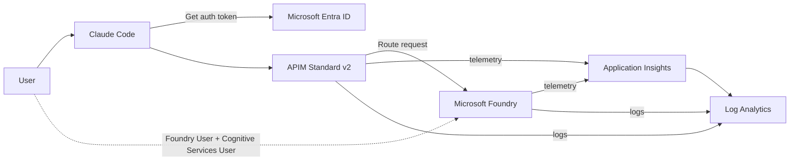
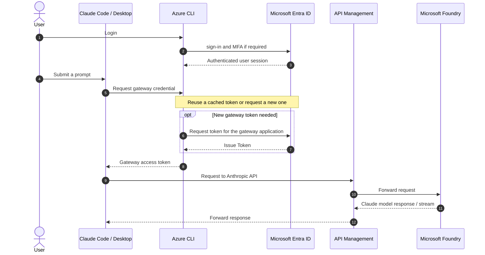

# Claude Code と Microsoft Foundry

[Terraform テンプレート](./azure_infra)を使って、**Azure 上でホストされる** Claude モデルをデプロイします。API Management を通じて Anthropic API にアクセスできます。設定と動作確認の方法は、[デプロイ手順](./DEPLOYMENT_JP.md)を参照してください。

## 構成

### リソース

次の Azure リソースをデプロイします。

| 名前 | 説明 |
| - | - |
| リソース グループ | |
| Azure API Management | |
| Microsoft Foundry | |
| Azure Application Insights | |
| Azure Log Analytics | |
| Entra ID アプリ登録 | |

既定では、次のモデルをデプロイします。`terraform.tfvars` ファイルで変更できます。

| デプロイ名 / モデル ID |
| --- |
| `claude-opus-5-5` |
| `claude-haiku-4-5` |
| `claude-sonnet-5` |
| `claude-opus-5` |
| `claude-sonnet-5-5` |
| `claude-haiku-5-5` |

ユーザーには、`Foundry User`、`Cognitive Services User`、`Log Analytics Reader` ロールも付与します。これにより、Foundry のモデルや監視データを確認できます。

## 認証

Azure CLI を使って、ユーザーの代わりにゲートウェイ用の有効期間が短い Entra トークンを取得します。
Claude Code または Desktop がこのトークンを APIM に送り、APIM が署名、発行元、有効期限、対象 API、アプリロールを確認します。
その後、APIM はユーザーのトークンを自身のマネージド ID のトークンに置き換えます。Foundry は `Cognitive Services User` ロールで APIM のアクセスを許可し、モデルの応答を返します。

## 監視とデータの扱い

Azure API Management (APIM)、Application Insights、Log Analytics を使って、監視データの一元管理、トークン使用量の確認、リクエスト数の制限を行います。

| サービス | 収集する監視データ |
| --- | --- |
| Application Insights | APIM のリクエストと依存関係のデータ、および `UserId` と `Model` ごとの `claudecode` トークン使用量。 |
| Log Analytics | Azure Monitor の APIM ゲートウェイログと、Microsoft Foundry のプラットフォーム診断ログ。 |
| Microsoft Foundry | Application Insights に接続した場合、対応する機能でプロジェクト単位の監視データを収集。 |
