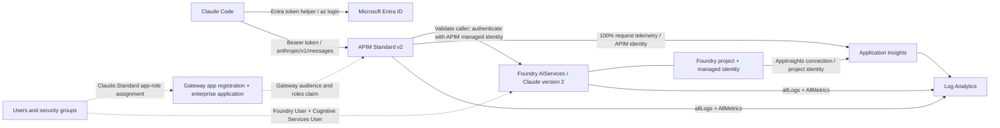

# Claude Code with Microsoft Foundry

The [Terraform templates](./src) provision Claude models **Hosted on Azure** and expose their native Anthropic API through API Management. See the [deployment guide](./DEPLOYMENT.md) for configuration, migration, and verification.

## Architecture

### Resources

- New resource group, public APIM Standard v2, and public `AIServices` Foundry account with key authentication disabled.
- Child Foundry project with its own system-assigned managed identity.
- Seven Claude deployments, pinned to **model version `2` (Hosted on Azure)**, with automatic upgrades disabled:

  | Deployment/model ID |
  | --- |
  | `claude-opus-4-8` |
  | `claude-opus-5-5` |
  | `claude-haiku-4-5` |
  | `claude-sonnet-5` |
  | `claude-opus-5` |
  | `claude-sonnet-5-5` |
  | `claude-haiku-5-5` |

- Single-tenant Entra app registration named `<prefix>-gateway`, its `api://<client-id>` identifier URI, the exposed `access_as_user` scope, and `Claude.Standard` app role. Its enterprise application requires assignment; configured users/groups/service principals receive the role. Azure CLI is preauthorized for the delegated scope. No client secret is created.
- APIM `POST /anthropic/v1/messages` and `POST /anthropic/v1/messages/count_tokens`, a named Foundry backend, app-role authorization/deployment allowlisting, per-identity request limits, and unbuffered response streaming.
- Per-caller token limits (default 50,000/minute) and monthly token quotas (default 5,000,000) across all allowed models. Messages token metrics include the original `UserId` and `Model`, not the shared backend identity. Token counting is authenticated and request-limited but isn't metered as inference.
- Workspace-based Application Insights, an APIM logger, and all-APIs diagnostics for **both** Application Insights and Azure Monitor with 100% request sampling and errors always logged.
- Diagnostic settings exporting **all log categories** and all metrics from APIM and Foundry to Log Analytics. Gateway logs use the resource-specific `ApiManagementGatewayLogs` table.
- `Monitoring Metrics Publisher` on Application Insights for APIM, Foundry account, and project identities. The project connection uses **ProjectManagedIdentity** (currently a preview Foundry capability); Application Insights local authentication is disabled.
- `Foundry User` and `Cognitive Services User` on the Foundry account for configured users/groups, plus `Log Analytics Reader` on Application Insights and the workspace.
- `Cognitive Services User` on the Foundry account for APIM's system-assigned identity, independently of user permissions.

Region, subscription eligibility, Marketplace access, and quota must be checked before deployment. `GlobalStandard` is the default; supported US `DataZoneStandard` deployments can be selected. A Global deployment isn't region-bound.

## Authentication

Claude Code uses **Anthropic gateway mode**, `ANTHROPIC_BASE_URL`, and the [Entra token helper](./client/get-claude-gateway-token.ps1). After `az login`, the helper obtains short-lived tokens for `api://<gateway-client-id>/.default`; Claude Code reruns it every five minutes. Despite Claude Code naming the setting `apiKeyHelper`, its output is an **Entra bearer token, not an API key**. APIM reads only `Authorization: Bearer`, not key headers.

APIM validates the tenant, signature, expiry, and **gateway app audience**, then requires the exact `Claude.Standard` role and a caller object ID before requesting any backend token. This registration requests **v2 access tokens**, whose `aud` is the app's client-ID GUID, not its `api://...` URI. Missing/invalid tokens return 401; a valid gateway token without the required role returns 403. Tokens for the Foundry AI/Cognitive Services audiences are deliberately rejected at the gateway.

APIM replaces the user's bearer token with its own system-assigned managed-identity token for `https://cognitiveservices.azure.com`. Foundry authorizes **APIM**, not the user, for gateway inference. APIM caches and refreshes this backend token. Client identity is captured before replacement for authorization, rate limits, quotas, and metrics. API-key headers are stripped, key-only requests cannot authenticate, and Foundry local authentication remains disabled. No client secrets, callback ports, or APIM subscription keys are used.

Entra evaluates user/group app-role assignments when issuing tokens; APIM no longer embeds group membership snapshots. Group-based enterprise-application assignment requires appropriate Entra licensing and supports **direct members, not nested groups**. Group membership changes need no Terraform update, but role/consent propagation and already-issued token lifetimes still apply; revocation isn't instantaneous. Changes to the configured assigned users/groups themselves still require Terraform apply.

This implements the article's gateway app registration and managed-identity backend option with one authorization tier (`Claude.Standard`) using the configured limits. It retains the existing `/anthropic` path rather than the article's root path. Optional premium-tier routing, model discovery, and private networking are not enabled. Native `CLAUDE_CODE_USE_FOUNDRY=1` must be removed/disabled because it requests a Foundry token instead of a gateway-app token.

Both services remain publicly reachable, without a VNet or private endpoints. Direct Foundry access by authorized users is possible and bypasses APIM limits/model restrictions. This is not a gateway-only network boundary.

## Observability and data handling

"Collect all" means all supported diagnostic categories and all gateway requests, not prompt/response payload capture. All four APIM request/response body limits are zero, and no headers are selected for logging. Don't add credentials to URLs, policy traces, or prompts. Review inherited policies and any existing per-API diagnostic overrides before rollout.

Application Insights records APIM requests/dependencies and `claudecode` token metrics dimensioned by `UserId` and `Model`; Log Analytics also receives Azure Monitor gateway logs and Foundry platform logs. Terraform enables custom metrics on the APIM Application Insights diagnostic and the component's preview **With dimensions** option. Connecting a project to Application Insights enables project telemetry where supported, but **does not instrument Claude Code or turn direct Claude Messages calls into Foundry Agent traces**. Additional client-side instrumentation would be required for that. These templates do not enable model payload logging, token-content logging, or agent-content capture.

Token limits/quotas are approximate and local to each gateway/region, not hard billing caps. Streaming counts can be estimated; concurrent calls can temporarily exceed limits. The limits return 429 for token/request rate exhaustion and 403 for monthly token quota exhaustion. The token policy counts prompt/completion tokens, not monetary cost or every cache/reasoning billing category.

100% sampling and dimensional custom metrics increase ingestion cost and can affect APIM performance. Metrics have cardinality limits (currently 100 values per dimension and 1,000 active time series per namespace at APIM); they are not an unlimited per-user billing ledger. Telemetry delivery is asynchronous and best-effort, not an audit guarantee. Budgets and alert rules are not included.

## Acceptance checklist

- [ ] All selected model IDs, **version 2**, region, SKU, capacity, and subscription/Marketplace eligibility are verified.
- [ ] The actual organization/country/industry attestations and current Marketplace terms are reviewed before applying.
- [ ] Terraform plan creates the gateway app/scope/enterprise application/app-role assignments, child project, connected Application Insights, both diagnostic pipelines, and scoped user/identity Azure role assignments.
- [ ] Claude Code completes a streamed task, tool use, and follow-up through APIM; token counting also works.
- [ ] Missing, expired, wrong-tenant, wrong-audience, and key-only requests fail; a valid gateway token without `Claude.Standard` receives 403.
- [ ] APIM's identity has `Cognitive Services User`; inference succeeds using that identity, and managed-identity failures never fall back to caller tokens or keys.
- [ ] Assigned users and direct group members obtain gateway tokens with `Claude.Standard`; unassigned users are denied issuance/access. Group changes take effect after propagation/token renewal without editing APIM policy.
- [ ] Unknown deployments are rejected; backend authorization, throttling, and error responses remain meaningful.
- [ ] Gateway logs and Application Insights requests appear after test traffic; configured users can query them.
- [ ] Token metrics carry the original user/model; request/token limits and monthly quota rejection are verified with controlled test limits.
- [ ] Successful and rejected requests are logged without gateway bodies or credential headers.

## References

- [Reference architecture: Entra-secured Claude clients and APIM, managed-identity option](https://techcommunity.microsoft.com/blog/azure-ai-foundry-blog/connecting-claude-clients-with-azure-api-management-and-claude-models-in-microso/4525212)
- [APIM managed-identity backend authentication](https://learn.microsoft.com/azure/api-management/authentication-managed-identity-policy)
- [Anthropic token limits on APIM v2](https://learn.microsoft.com/azure/api-management/llm-token-limit-policy)
- [LLM token metrics and cardinality limits](https://learn.microsoft.com/azure/api-management/llm-emit-token-metric-policy)
- [Azure team explanation of the preview custom-metrics dimension property](https://github.com/Azure/bicep-types-az/issues/2048)
- [Claude Code gateway credentials and token helpers](https://code.claude.com/docs/en/llm-gateway-connect#rotate-credentials-with-apikeyhelper)
- [Entra access-token audience claims](https://learn.microsoft.com/entra/identity-platform/access-token-claims-reference)
- [Deploy and use Claude models, including Hosted on Azure version 2](https://learn.microsoft.com/azure/foundry/foundry-models/how-to/use-foundry-models-claude)
- [Official Claude Terraform starter and Marketplace attestations](https://github.com/Azure-Samples/claude/tree/main/infra-terraform)
- [APIM Application Insights integration](https://learn.microsoft.com/azure/api-management/api-management-howto-app-insights)
- [APIM Azure Monitor logging](https://learn.microsoft.com/azure/api-management/api-management-howto-use-azure-monitor)
- [Foundry Entra-authenticated trace ingestion](https://learn.microsoft.com/azure/foundry/observability/how-to/trace-ingestion-entra-authentication)
- [Foundry managed-identity Application Insights connection example](https://github.com/microsoft-foundry/foundry-samples/blob/main/infrastructure/infrastructure-setup-bicep/20-user-assigned-identity/main.bicep)
